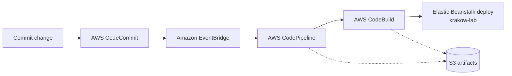
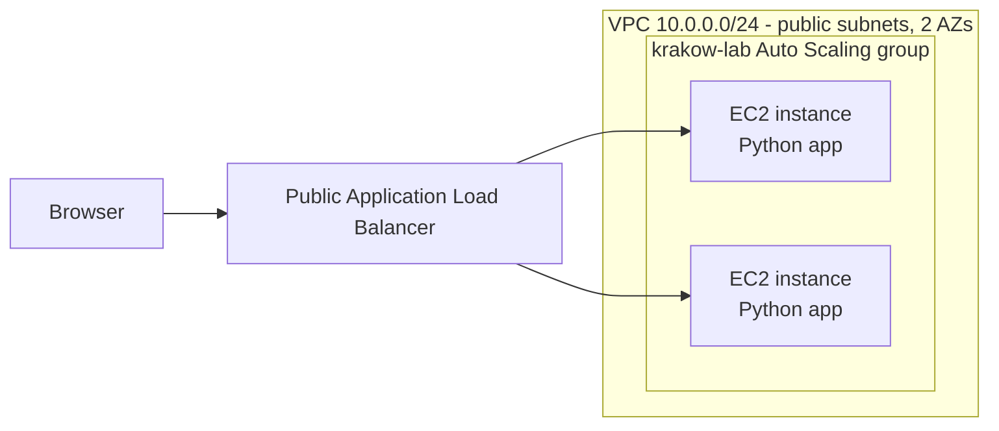
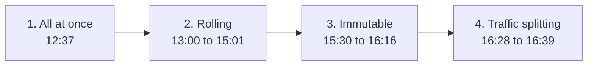

# AWS Elastic Beanstalk Deployment & CI/CD Automation

**Python app · Manual v1 deployment · CodeCommit + EventBridge + CodePipeline · Deployment strategies**

> Author: Hussein Al-Attas

---

## Table of Contents

1. [Project Overview](#1-project-overview)
2. [Architecture Diagram](#2-architecture-diagram)
   * [Delivery Workflow](#delivery-workflow)
   * [Application Hosting](#application-hosting)
3. [Technology Stack](#3-technology-stack)
4. [Prerequisites & Initial Configuration](#4-prerequisites--initial-configuration)
5. [Manual Deployment Using Elastic Beanstalk](#5-manual-deployment-using-elastic-beanstalk)
6. [Automating Elastic Beanstalk with AWS CI/CD](#6-automating-elastic-beanstalk-with-aws-cicd)
7. [Deployment Strategies & Testing](#7-deployment-strategies--testing)
   * [7.1 Deployment Strategy Journey: All at Once to Traffic Splitting](#71-deployment-strategy-journey-all-at-once-to-traffic-splitting)
     * [The Journey in One View](#the-journey-in-one-view)
     * [Step by Step](#step-by-step)
     * [What Changed at Each Step](#what-changed-at-each-step)
     * [Key Observations from the Logs](#key-observations-from-the-logs)
     * [Trade-offs of Each Strategy](#trade-offs-of-each-strategy)
     * [Takeaways](#takeaways)
8. [Errors & Fixes](#8-errors--fixes)
9. [AWS-Screenhots](#9-log-history)
10. [References](#10-references)

---

## 1. Project Overview

Deploy a Python web application showcasing cartoon-style images of Kraków using AWS Elastic Beanstalk, progressing from manual deployment to CI/CD automation.
Test different deployment strategies using visibly distinct application versions (V1 and V2) to simulate production releases and evaluate their impact on application availability, deployment time, and infrastructure capacity.

**Objectives**

* Understand the distinction between an application, application version, and environment.
* Deploy a Python application manually before automating delivery.
* Connect source-code changes to an automated deployment pipeline.
* Compare deployment strategies through browser behavior and infrastructure changes.
* Troubleshoot networking, health, triggers, and release visibility.

**Release identification**

Background color makes each release easy to tell apart in the browser:

| Release | Visual identifier |
|---------|-------------------|
| V1      | Teal              |
| V2      | Orange            |

Release settings are controlled through a `release.json` file, so releases can change without repeatedly editing the main application:

```json
{
  "version": "v1",
  "theme": "teal",
  "health_ok": true
}
```

> **Release vs. deployment policy:** the release determines the application's color and version. The deployment policy determines *how* that release reaches the instances. Changing the policy alone does not change the application's appearance.

---

## 2. Architecture Diagram


*Figure 1.*


---

*Figure 2.*


### Delivery Workflow



The source-control service is **AWS CodeCommit** (not GitHub). A repository/branch change event captured by **Amazon EventBridge** starts CodePipeline, which retrieves the revision, invokes CodeBuild, and deploys the resulting artifact to `krakow-lab`. EventBridge is AWS's recommended event-based change-detection method for a CodeCommit source.

### Application Hosting



Browser requests reach a public Application Load Balancer, which routes them to healthy Python application instances. Elastic Beanstalk manages provisioning, load balancing, scaling, and health monitoring.

---

## 3. Technology Stack

| Layer | Technology |
|-------|------------|
| Application | Python web app |
| Hosting platform | AWS Elastic Beanstalk (`krakow-lab`) |
| Compute | Amazon EC2 in an Auto Scaling group |
| Load balancing | Public Application Load Balancer |
| Networking | VPC `10.0.0.0/24`, Internet Gateway, public subnets across two Availability Zones |
| Source control | AWS CodeCommit |
| Pipeline trigger | Amazon EventBridge |
| Orchestration | AWS CodePipeline |
| Build | AWS CodeBuild |
| Artifact storage | Amazon S3 |

---

## 4. Prerequisites & Initial Configuration

The lab used a public-network design:

* VPC address range `10.0.0.0/24`
* Internet Gateway
* Public subnets across two Availability Zones
* Public Application Load Balancer
* Public IPv4 connectivity for application instances

**Monitoring and validation points used throughout the lab**

| Observation point | Purpose |
|-------------------|---------|
| Browser background color | Identify the release serving a request |
| `/version` response | Check the reported application version |
| Pipeline execution | Confirm source, build, and deployment progress |
| Elastic Beanstalk Events | Follow deployment actions and failures |
| Environment and target health | Check whether instances were ready to serve traffic |
| EC2 instance list | Observe temporary capacity and instance replacement |
| Auto Scaling activity history | Investigate instance launches and terminations |


---

## 5. Manual Deployment Using Elastic Beanstalk

1. Deploy **V1 (teal)** manually to `krakow-lab`.
2. Troubleshoot initial health problems (see [Errors & Fixes](#8-errors--fixes)) until the environment reports healthy with version 1.
3. Manually deploy **V2 (orange)** using the **Rolling** deployment policy.

---

## 6. Automating Elastic Beanstalk with AWS CI/CD

The automated pipeline consists of:

1. **Source:** retrieves the revision from CodeCommit (triggered by EventBridge).
2. **Build:** CodeBuild builds the application and creates an artifact.
3. **Deploy:** deploys the artifact to the existing Elastic Beanstalk environment `krakow-lab`.

All three pipeline stages (Source, Build, Deploy) were confirmed green.

**Workflow for each strategy test**

1. Change the environment's deployment policy.
2. Wait for the configuration update to finish.
3. Commit the next release.

---

## 7. Deployment Strategies & Testing

> The goal was to test different deployment strategies by releasing new application versions, observing pipeline triggers and application updates, and seeing how AWS automatically launches and terminates EC2 instances throughout the process. This helped me understand how deployments work and how AWS maintains application availability.

### 7.1 Deployment Strategy Journey: All at Once to Traffic Splitting

Environment `Krakow-lab` on AWS Elastic Beanstalk (eu-central-1, 2 instances). All steps were done on October 29, 2026, between 12:37 and 16:39.

#### The Journey in One View



#### Step by Step

| Step | Strategy | Time | Result | What happened |
| --- | --- | --- | --- | --- |
| 1 | All at once (Manual v1) | 12:37 to 12:40 | Succeeded | First state of the application. The strategy was not changed. In-place deployment on all instances at once. |
| 2 | Rolling | 13:00 to 15:01 | Succeeded (3 runs) | Deployed in 2 batches of 1 instance, so one instance kept serving traffic. About 5 to 6 minutes per run. One run at 14:25 failed because the CodePipeline role was missing `cloudformation:GetTemplate`. |
| 3 | Immutable | 15:30 to 16:16 | 4 failed, then 2 succeeded | The first 4 attempts failed with a 403 on the launch template when creating the temporary Auto Scaling group. Later runs succeeded: new instances were built beside the old ones, then swapped in. About 14 to 15 minutes per run. |
| 4 | Traffic splitting | 16:28 to 16:39 | Succeeded | 10% of traffic went to the new version for a 5 minute evaluation, then 100%. About 11 minutes. |

#### What Changed at Each Step

1. **All at once to Rolling:** from updating every instance together to updating one at a time, so the application stays available during a deployment.
2. **Rolling to Immutable:** from updating instances in place to launching new instances and replacing the old ones only after the new ones are healthy. Slower, but safer.
3. **Immutable to Traffic splitting:** the same new-instances approach, plus a controlled 10% traffic test before the full switch.

#### Key Observations from the Logs

- **Both failures were permission errors, not application errors.** At 14:25 the CodePipeline role was not allowed to run `cloudformation:GetTemplate`. At 15:30 to 15:42 the Auto Scaling service returned 403 AccessDenied on the launch template. Nothing in the logs points to a problem with the application itself.
- **Failed immutable runs were safe.** Each one stopped while creating the temporary Auto Scaling group, terminated the new resources, and left the running version untouched.
- **Retrying did not help.** Each of the 4 failed attempts created a new launch template (a different `lt-` ID each time) and hit the same 403. The log does not say what changed before the 15:47 run succeeded.
- **The environment was ready for advanced strategies from the start.** The creation step already built an Application Load Balancer with a listener and target group, an Auto Scaling group with scale-up and scale-down policies, two CloudWatch alarms, and two security groups. Traffic splitting needs an Application Load Balancer, so no infrastructure change was needed to use it.
- **Instance counts per strategy.** Rolling updated 1 of 2 instances at a time. Immutable launched 1 test instance, then the rest (2 new instances in total). Traffic splitting launched 2 test instances.
- **Overall time.** From environment creation to the last successful deployment took about 4 hours, including the failed attempts.

#### Trade-offs of Each Strategy

| | All at once | Rolling | Immutable | Traffic splitting |
| --- | --- | --- | --- | --- |
| Deploys to | All instances in place | Batches in place | New instances | New instances |
| Traffic test first | No | No | No | Yes, 10% for 5 min |
| Observed time | about 3 min | about 5 to 6 min | about 14 to 15 min | about 11 min |
| Downtime risk | Highest: all instances update together | Lower: other instance keeps serving, but capacity drops during a batch | Lowest: old instances serve until new ones are healthy | Lowest: and real traffic validates the new version |
| Rollback | Redeploy the previous version | Redeploy the previous version | Terminate the new instances, old ones are untouched | Traffic can stay on the old version if the evaluation fails |
| Extra cost while deploying | None | None | Temporary extra instances | Temporary extra instances |
| Good fit | Development and test | Production with some tolerance for reduced capacity | Production where safety matters more than speed | Production where you want to test with real traffic first |

#### Takeaways

1. Each step traded speed for safety: about 3 minutes with All at once, up to about 14 to 15 minutes with Immutable.
2. Check the permissions of the role that runs the deployment before changing strategy. Immutable and Traffic splitting create new launch templates and Auto Scaling groups, and they need extra permissions that All at once and Rolling did not.
3. Traffic splitting gave the most control, with a 10% test for 5 minutes, and it finished faster than Immutable.

---

## 8. Errors & Fixes

Severe environment health
Observation: Load-balancer health checks failing or unavailable; instances not reporting health data.
Resolution / status: An instance had no public IPv4 address. Troubleshooting covered public-IP configuration, Internet Gateway routing, subnet associations, and target health. krakow-lab later became healthy with version 1.


---

## 9 AWS-Screenhots


> How did the app look like?


--- 

> Manual deployment of Python application


---

> Green Pipeline Deployment to EB


---

> Checking Heath, Request, Versions, instances


---

> EB requires permissions across AWS services and Resources


---

> Observing the changes from Rolling with batches -> Immutable, how instances changes


## 10. References

1. [AWS Elastic Beanstalk documentation](https://docs.aws.amazon.com/elastic-beanstalk/)
2. [AWS CodePipeline: migrate polling pipelines to event-based change detection](https://docs.aws.amazon.com/codepipeline/latest/userguide/update-change-detection.html)
3. [AWS Elastic Beanstalk: deployment policies and settings](https://docs.aws.amazon.com/elasticbeanstalk/latest/dg/using-features.rolling-version-deploy.html)
4. [AWS Elastic Beanstalk: service overview and pricing model](https://aws.amazon.com/elasticbeanstalk/)
